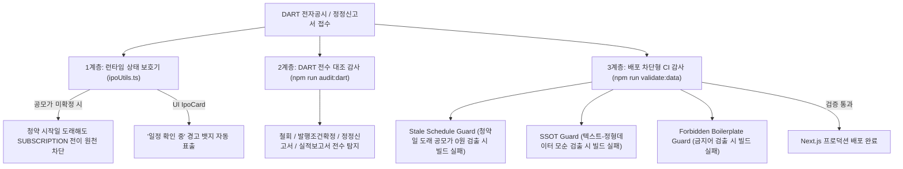

# 공모주 데이터 무결성 및 공시 동기화 표준 운영 프로세스 (SOP)

본 문서는 공시 일정 연기, 공모가 미확정 상태에서의 청약 상태 오표기, 텍스트와 정형 데이터 간의 모순 등 운영상 오류를 원천 방지하기 위해 구축된 표준 프로세스 및 자동 방어 체계를 정의합니다.

---

## 1. 핵심 불변 원칙 (Core Invariants)

1. **공모가 미확정 청약 불가능 원칙**
   - 대한민국 자본시장법 및 증권인수업무 규정상, **확정 공모가가 0원(미확정)인 상태에서는 어떠한 경우에도 일반 청약(`SUBSCRIPTION`)이 진행될 수 없습니다.**
   - 청약 시작일이 도래했더라도 확정 공모가가 없으면 시스템은 이를 `UPCOMING(청약 예정)` 상태로 강제 유지하며, UI에서는 `일정 확인 중` 경고 뱃지를 노출합니다.
2. **단일 진실 공급원(SSOT) 원칙**
   - 공모 일정, 희망/확정 공모가, 주관사 정보는 정형 데이터 필드(`subscriptionStart`, `underwriters`, `confirmedPrice` 등)가 유일한 진실입니다.
   - `aiSummary.bulletPoints` 등의 자연어 텍스트는 기업 비즈니스 모델 및 투자 포인트 중심으로 작성하며, 정형 데이터와 모순되는 자연어 텍스트는 CI 감사 단계에서 배포가 자동 차단됩니다.
3. **미검증 보일러플레이트 금지 원칙**
   - 증권신고서 접수 후 법정 대기 기간(15영업일) 중에는 "효력 발생 완료" 표기를 사용할 수 없습니다.
   - 펀더멘털이나 공모 구조에 대한 주관적 수식어("우수한 펀더멘털", "안정적인 공모 구조")는 공시 감사 및 실적 검증 전까지 사용할 수 없습니다.

---

## 2. 3계층 자동 방어 시스템 (Automated Safeguards)

### Layer 1: 런타임 상태 방어 (`src/lib/ipoUtils.ts` & `src/components/IpoCard.tsx`)
- `getEffectiveIpoStatus()`:
  - `today >= subscriptionStart` 조건이 성립하더라도, `confirmedPrice <= 0`인 경우 절대로 `SUBSCRIPTION`을 반환하지 않고 `UPCOMING`을 유지합니다.
- `IpoCard`:
  - 청약 시작일이 도래했으나 공모가가 미확정인 종목은 `"청약 진행 중"` 대신 **`"일정 확인 중"` (주황색 뱃지)**을 표시하여 사용자 혼선을 예방합니다.

### Layer 2: DART 공시 전수 대조 감사도구 (`npm run audit:dart`)
- 최근 60일간의 DART 지분증권(C001) 공시 목록을 실시간 전수 조회하여 다음 5대 괴리를 즉시 보고합니다:
  1. DART 공모 철회 공시 접수 시 DB 미반영 여부
  2. DART 증권발행실적보고서 접수 시 상장대기 전환 누락 여부
  3. DART 발행조건확정 공시 접수 시 공모가 0원 방치 여부
  4. DART 최신 기재정정공시(일정/조건 연기) 접수 시 미반영 여부
  5. 청약 시작일 도래 종목의 공모가 미확정 상태 여부

### Layer 3: 배포 사전 차단 무결성 감사 (`npm run validate:data`)
- Next.js 프로덕션 빌드(`npm run build`) 실행 전 `prebuild` 훅으로 강제 실행됩니다:
  1. **Stale Schedule Guard**: 오늘 날짜 기준 청약 시작일이 도래했으나 확정 공모가가 0원인 종목이 있으면 **즉시 exit code 1로 빌드 중단**.
  2. **SSOT Guard**: `bulletPoints`나 메모 내 주관사/유통비율이 정형 데이터와 0.01이라도 다르면 **빌드 중단**.
  3. **Forbidden Boilerplate Guard**: "효력 발생 완료", "우수한 펀더멘털" 등 허위/미검증 문구 검출 시 **빌드 중단**.

---

## 3. 공식 일정의 선별 주기 검증 (2026-10-30)

매일 오전 7시(한국시간)에 예약된 GitHub Actions에서 신규공시 발견 → 공식 일정 검증 → 금융지표·신규 상장성과 → D-1 리뷰 순으로 처리합니다. D-1 저장 누락·실패·부분실패는 청약 기간 중 회당 최대4종목을 추가 복구하며 실제 수집 시각을 보존합니다. 정상·빈 결과는 재시도하지 않습니다. 수동 전수 확인을 매번 요구하지 않습니다. 예약 지연·누락 가능성이 있으므로 설정만으로 실제 실행·배포를 완료했다고 보고하지 않습니다.

날짜가 도래했는지에 따른 검증은 서비스와 같은 ID·종목코드·법인코드 교체 순서로 합친 실제 유효 레코드에 적용합니다. 교체된 초기자료의 미확정 공모가가 최신자료의 저장을 막지 않게 하며, 두 원본별 정적 금액·근거 검사는 유지합니다. 저장 전 검증 실패 또는 커밋·push 실패 시 수집자료 복구 artifact를 7일 보존하고 요약에 검증 결과를 남깁니다. 검증 실패 자료를 자동으로 운영에 올리지 않습니다.

- 신규 접수번호, 파서 변경, 등록 일정 변경은 다음 실행에서 우선 확인합니다. 일정까지 2일 이내는 6시간, 7일 이내는 24시간, 그 밖은 72시간의 재확인 간격을 적용합니다. 실제 조회는 이 간격이 지난 뒤 도래하는 예약 실행에서 이루어집니다.
- DART는 접수번호·파서 버전별로 검증한 본문 결과를 재사용합니다. 첨부정정이면 DART가 연결한 최신 본문만1단계 따라가며 동일법인코드·법인명·3요청한도를 확인합니다. 실제본문공시일/URL과첨부정정연결근거를분리보존합니다. 증권사별 공지 목록은 실행 내 1회 공유하고 정확한 회사명의 최신 공지를 선택합니다. 같은 날 증권사 공지는 등록시각이 더 늦은 것을 우선하며, 날짜만 있는 DART와 같은 날 충돌하면 임의로 선택하지 않습니다.
- 일반청약일·환불일·상장일·확정가격은 명시된 항목만 반영합니다. 기관 증거금 면제, 납입일, 수수료를 개인 조건이나 환불일로 추정하지 않습니다. 현재 지원 증권사 어댑터는 한국투자증권·IBK투자증권입니다. 다른 증권사의 전용 공지를 모두 지원한다고 주장하지 않습니다.
- 상장일 미정이 명시되면 미정근거를 저장합니다. 더 최신인 증권사 상장예정일 공지가 있으면 그 날짜를 유지하고, 최신 미정근거를 과거 날짜로 덮어쓰지 않습니다. 원문조회실패와 명시 미정은 구분하며, 미정 본문은 같은접수번호로 재수신하지 않고 새공시/파서변경 때 재확인합니다.
- 새 값에는 값 자체·원문 URL·공시/공지일·확인시각·짧은 발췌·파서 버전을 함께 저장합니다. 기존의 더 최신인 수동 공시근거도 과거 공지로 덮어쓰지 않습니다. 비공식38 포털은 차이 보고만 하고 값을 바꾸지 않습니다.
- 모호한 표·충돌·조회 실패는 기존 값을 보존하고 conflict 또는 unavailable로 기록합니다. 일부 항목만 추출하면 partial이며 전체 검증 완료가 아닙니다. HTTP200 오류 화면은 미발표 근거로 인정하지 않습니다.
- 일정 검증은 회당 최대12종목·HTTP30회이며, 취소/저장된 상장종목은 대상에서 제외합니다. 실패 시 6→12→24→48시간으로 재시도 간격을 늘립니다. 새 정정공시가 발견되면 즉시 다시 대상에 넣습니다. 금융 원문도 성공/명시 발표대기 결과를 캐시하고 실패 간격을 늘립니다.
- 공식 일정·신규 공시 조회는 헤더와 본문 전체에45초 제한을 적용합니다. 개별HTTP읽기는 일시적인 연결·본문 수신 실패만1회 즉시 재시도하며 부분 본문은 버립니다. 재시도도30HTTP 및 DART단일접수3HTTP 예산에 포함됩니다. HTTP거절·인증서·원문구조 오류에는 이 즉시 재시도를 하지 않습니다. 공식 일정 CLI의 아래1회 지연 복구까지 실패하면 다음 예약의 backoff를 적용합니다. 조건부304는 같은 파서의 정상 캐시가 있을 때만 재사용합니다.
- 공식 일정 CLI는 이번 실행에서 새로unavailable가 된 대상만30초 후1회 재검증합니다. 해당 대상의 실패 원문/대상 backoff만 이번 복구에 한해 허용하며 정상 캐시는 유지합니다. 두 pass 합계30HTTP와12개서로다른대상 한도를 공유하고 예산이 없으면 미해결로 남깁니다. 해결된 오류만 최종 결과에서 해제하고 처음/복구 이력 및 먼저 적용된 변경은 보존합니다. 이전backoff 때문에 조회0건이어도unavailable/conflict가 남아 있거나 선택한12개 안에서 HTTP예산 미처리가 있으면 미해결로 보고하며 CLI는실패입니다. 정상12개대상선택상한밖의주기대기전체를오류로확대하지않습니다.
- 조회 캐시·재시도 이력은 .cache/의 Actions 캐시에 보존하고 실행 증거는7일 artifact로 남깁니다. 값·출처·검증 상태가 같으면 확인시각만 바뀌었다고 데이터 커밋/배포하지 않습니다. 캐시가 사라져도 요청 예산을 적용해 다시 확보하며 기존 공개자료를 삭제하지 않습니다.
- 신규 상장성과는 값과 연결된 공식 상장일 근거가 있고 충돌/조회실패가 없을 때만 조회·저장합니다. 이미 저장된 성과는 다시 수집하지 않습니다.
- 금융 단계는 청약 종료 후 코드·상장일 또는 가격이 미완료인 종목을 KIND 상장법인 전체 목록으로 대조합니다. 정상 응답은 1요청이며, KIND에 한해 연결/본문 오류·HTTP408/429/500/502/503/504·비정상/빈 목록을 1초/2초 간격으로 총3요청까지 재시도합니다. 각 요청의 본문 포함45초 제한과3MB 한도를 유지하며 이전 부분 본문을 재사용하지 않습니다. HTTP403/404·인증서·리다이렉트·크기 초과는 즉시 실패합니다. 네이티브 fetch의 manual 모드로 리다이렉트 응답을 거절하며 목적지를 따라가지 않습니다. 요청별 고정 오류분류/HTTP상태/문자수만 남기고 원본 오류/본문은 로그에 넣지 않습니다. 지속 실패는 전체 실패로 유지합니다. 이 예외는 일반 DART/증권사 재시도 정책을 변경하지 않습니다.
- 원시 상태가 UPCOMING이어도 청약 종료일이 지났으면 포함하고, 회사명은 법인 접두어·기업인수목적/스팩 표기만 정규화하여 정확히 일치시킵니다. 근거 없는 등록 미래 상장일로 이 복구 조회를 생략하지 않습니다. 동명이인·기존 시장과의 불일치·다른 기업의 코드 충돌·청약 이전 상장일은 저장하지 않습니다. 미확인 시장은 거래소 행으로 보완하며 아직 상장되지 않은 기업은 대기로 남깁니다.
- KIND 목록의 회사명·시장·코드·상장일 행과 조회시각을 항목 근거에 보존합니다. 전체 목록은 코드/상장일 근거에만 사용할 수 있으며 점수 지표나 기업 전체 검토 완료의 근거가 아닙니다. 일반 공시 조회 실패 후에도 KIND를 재확인해 상장성과 복구가 계속되도록 합니다.
- 가격 조회 전에 네이버 증권의 회사명·코드·주식 종류를 대조합니다. ETF나 다른 기업 시세는 거절합니다. 정규장 일봉을 우선하고 시간외 실시간 가격을 상장일 종가로 확정하지 않습니다. 가격 저장 시 거래일·원천 URL·조회시각을 보존하며, 공식 상장일·공모가 대기 사유는 종목명과 함께 실행 요약에 남깁니다.
- DART 수치는 [공식 원본파일 API](https://opendart.fss.or.kr/guide/detail.do?apiGrpCd=DS001&apiId=2019003)를 우선 사용합니다. 정확한 접수번호 XML의 현행 모집 PART만 선택하며 큰 PART는 기존 뷰어와 동일하게 일반사항·투자위험요소로 분할합니다. 인증키는 요청 메모리에서만 사용하고 로그·출처 URL·캐시에 넣지 않습니다. 원본이 없거나 형식·무결성 검사가 실패하면 기존 뷰어로 대체합니다. 어느 경로도 실패한 자료를 정상 또는 0으로 채우지 않습니다.
- 금융 파서는 1회5분의 조회 예산을 적용하며 시작한 접수1건은 기존 요청 제한 내에서 마칩니다. 남은 접수는 종목명과 함께 시간 예산 보류로 기록하고 그 결과 자체를 성공으로 처리하지 않습니다. CLI의 아래 청크 복구 한도 안에서 이어 처리하고, 끝내 남으면 다음 예약에서 재개합니다. 일정·금융이 연속으로 느릴 때의 저장 여유를 위해 작업의 최종 제한은45분입니다.
- 금융 CLI는 오류 없는 시간 예산 보류에 한해 같은 작업 안에서 최대3청크로 이어 처리합니다. 하나의 수치 캐시를 공유하고 매 청크마다 저장하며, 처리량이 줄지 않거나 전체12분이 지나면 새 청크를 시작하지 않습니다. 마지막 접수는 기존 요청 제한 내에서 마무리하므로 12분은 강제 종료 시각이 아닙니다. 앞서 저장된 갱신과 최종 미해결 목록을 모두 보존하고 가격은 마지막 공시 처리 후 한 번 실행합니다. 원문·의미 충돌·설정·캐시 저장 오류는 이 청크 복구 대상이 아니며 기존 실패 backoff를 우회하지 않습니다.
- KIND3요청이 일시 오류로 끝나면 금융 CLI가30초 후 한 번 더 실행합니다. 총6HTTP를 넘지 않으며 충분한 전체 시간 예산이 없거나403/404·리다이렉트·크기·TLS·법인충돌·저장실패이면 추가 시도하지 않습니다. 회복한 오류와 지속 오류를 실행 이력과 최종 결과에서 구분하며 마지막 실패를 성공으로 표시하지 않습니다.
- 개별 최신 공시 해석 실패와 예산 보류의 exact code를 새 가격 저장 차단 목록으로 전달합니다. 목록 전체 조회/페이지 실패, 키 누락, 캐시 예외는 안전한 대상 구분이 불가능하므로 모든 신규 가격 저장을 보류합니다. 공개 KIND복구와 기존 완결가격 동결은 계속 수행합니다. 과거 공모가를 사용한 잘못된 수익률이 영구 저장되는 경로를 차단합니다.
- 가격 HTTP는 전체15초/1MB, 기존 소켓 무응답5초 제한을 적용하고 실패 시 요청·응답을 닫습니다. 계속 조금씩 오는 응답도 전체 제한을 넘길 수 없습니다. 가격 단계의 새 종목 조회 시작은3분으로 제한하며, 이미 시작한1종목은 제한된 요청 내에서 마칩니다. 남은 미완결 종목은 명시적인 예산 보류·오류로 유지하고 저장된 값은 보존합니다.
- KIND·DART·시세 단계의 예외를 개별 실패로 집계합니다. DART 키 누락·캐시 손상·저장 예외가 있어도 공개KIND복구와 시세 단계의 상태 검사는 실행하며, 최신 공모가를 확인하지 못한 신규 시세 저장은 위 차단 정책을 따릅니다. 실제 두 가격이 완결된 종목만 지표 변경에서 제외하고, 원시LISTED 상태의 미완결 종목은 공모가를 보완할 수 있습니다.
- 당일 가격은 18시 이후에만 확정 저장합니다. 과거 상장일은 다음 날 오전에도 재수집할 수 있습니다. 그 시점이 지났는데 공식 상장일 근거·코드·공모가가 없어 시세가 누락되면 보류 사유와 실패를 함께 표시합니다. KIND에서 실제 상장을 확인한 경우 환불일 등 무관한 항목의 충돌은 시세 저장을 막지 않으며 상장일·공모가 충돌은 계속 차단합니다.
- 저장된 가격 근거의 코드·거래일이 현재 코드·상장일과 달라지면 기존 가격은 보존하고 오류로 보고합니다. 근거가 없던 기존 완결 레코드의 재조회는 하지 않습니다.
- 금융 파서 v5는 현행 공모개요의 총 공모주식수·단가·총액을 명시 확정가격과 대조해 공모금액을 억원으로 저장합니다. `(주N) 정정 전/후`를 구분하고 이전 표·예정 범위·배정표·단위 혼동·수량×단가 불일치는 사용하지 않습니다. 값 변경 후 새 항목 근거를 다시 연결하며 단순 확인시각 변경은 커밋 사유가 아닙니다.
- 확정가격이 바뀌면 공시 수량과 산술이 맞지 않는 종전 공모금액·시총은 미등록으로 돌리고 근거를 무효화합니다. 새 수량으로 같은 총액이 유지되는 경우는 보존할 수 있습니다. 사업 개요·분석 메모 변경은 이전 전체 검토 상태를 무효화하며 사업 설명의 자동 의미 검증으로 간주하지 않습니다.
- 수집 중 기본 브랜치가 바뀌면 자료 커밋을 안전하게 rebase하고 다시 검증한 뒤 최대 3회 push합니다. 같은 자료에 충돌하면 원격을 덮어쓰지 않고 실패하며 수집 JSON 2개를 7일 복구 artifact로 보존합니다. 이 artifact는 운영 반영이나 자동 충돌 해결을 뜻하지 않습니다.

### 과거 기록의 근거 있는 수동 정정

- 완결 가격의 자동 동결은 정확성 검증을 뜻하지 않습니다. 2026-11-01 사용자 정정 지시처럼 공식 회사명·코드·상장일·해당 회차 공시를 다시 확인한 편집 정정은 원본 백업과 전후 값·근거 기록을 남기고 수행합니다. 기본/커스텀 중복 기록도 함께 고쳐 구값이 복원되지 않게 합니다.
- 신청 기준 확약과 배정 후 확약을 구분합니다. 주식분할·증자로 수정된 과거 차트 가격을 당시 원시 공모가와 섞지 않으며, 필요한 경우 당시 원시 거래가격을 보고한 자료로 교차 확인합니다.
- 빌드 감사는 모든 항목별 근거의 값, 가격 근거의 회사 코드·거래일, 공모가 대비 시가·종가 수익률을 대조합니다. 이 검사는 자료 내부의 모순을 막는 것이며 원문의 진위나 모든 외부 사실을 자동 인증하지 않습니다.
- 뉴스레터는 기존 원문 검토 조건에 더해 검증 상태가 존재하면 verified인 종목만 사용합니다. 자동 확인이 기업 전체 검토나 외부 원고 발행 승인을 대체하지 않습니다.

특정 오류종목만 재처리할 때는 --stock exact-id를 반복 지정합니다. 지정하지 않은 자료와 캐시는 보존합니다.

실행: npm run verify:official -- --dry-run (조회 미리보기), npm run verify:official -- --write (로컬 자료와 캐시 저장). 커밋·운영 배포는 별도입니다. 기존 글·인스타그램·이메일 실제 발송은 이 검증 명령에서 실행하지 않습니다.

DART 접수정보 감사의 차이 없음은 본문 전체 일치를 뜻하지 않습니다. validate:data는 로컬 형식·논리·출처 연결 검사이며 원격 진위 검증을 대신하지 않습니다.
