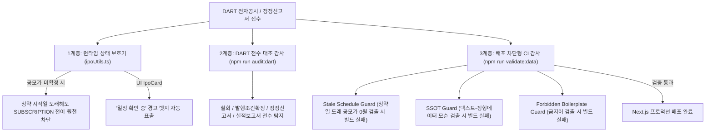

# 공모주 데이터 무결성 및 공시 동기화 표준 운영 프로세스 (SOP)

본 문서는 공시 일정 연기, 공모가 미확정 상태에서의 청약 상태 오표기, 텍스트와 정형 데이터 간의 모순 등 운영상 오류를 원천 방지하기 위해 구축된 표준 프로세스 및 자동 방어 체계를 정의합니다.

---

## 1. 핵심 불변 원칙 (Core Invariants)

1. **공모가 미확정 청약 불가능 원칙**
   - 대한민국 자본시장법 및 증권인수업무 규정상, **확정 공모가가 0원(미확정)인 상태에서는 어떠한 경우에도 일반 청약(`SUBSCRIPTION`)이 진행될 수 없습니다.**
   - 청약 시작일이 도래했더라도 확정 공모가가 없으면 시스템은 이를 `UPCOMING(청약 예정)` 상태로 강제 유지하며, UI에서는 `일정 확인 중` 경고 뱃지를 노출합니다.
2. **단일 진실 공급원(SSOT) 원칙**
   - 공모 일정, 희망/확정 공모가, 주관사 정보는 정형 데이터 필드(`subscriptionStart`, `underwriters`, `confirmedPrice` 등)가 유일한 진실입니다.
   - `aiSummary.bulletPoints` 등의 자연어 텍스트는 기업 비즈니스 모델 및 투자 포인트 중심으로 작성하며, 정형 데이터와 모순되는 자연어 텍스트는 CI 감사 단계에서 배포가 자동 차단됩니다.
3. **미검증 보일러플레이트 금지 원칙**
   - 증권신고서 접수 후 법정 대기 기간(15영업일) 중에는 "효력 발생 완료" 표기를 사용할 수 없습니다.
   - 펀더멘털이나 공모 구조에 대한 주관적 수식어("우수한 펀더멘털", "안정적인 공모 구조")는 공시 감사 및 실적 검증 전까지 사용할 수 없습니다.

---

## 2. 3계층 자동 방어 시스템 (Automated Safeguards)

### Layer 1: 런타임 상태 방어 (`src/lib/ipoUtils.ts` & `src/components/IpoCard.tsx`)
- `getEffectiveIpoStatus()`:
  - `today >= subscriptionStart` 조건이 성립하더라도, `confirmedPrice <= 0`인 경우 절대로 `SUBSCRIPTION`을 반환하지 않고 `UPCOMING`을 유지합니다.
- `IpoCard`:
  - 청약 시작일이 도래했으나 공모가가 미확정인 종목은 `"청약 진행 중"` 대신 **`"일정 확인 중"` (주황색 뱃지)**을 표시하여 사용자 혼선을 예방합니다.

### Layer 2: DART 공시 전수 대조 감사도구 (`npm run audit:dart`)
- 최근 60일간의 DART 지분증권(C001) 공시 목록을 실시간 전수 조회하여 다음 5대 괴리를 즉시 보고합니다:
  1. DART 공모 철회 공시 접수 시 DB 미반영 여부
  2. DART 증권발행실적보고서 접수 시 상장대기 전환 누락 여부
  3. DART 발행조건확정 공시 접수 시 공모가 0원 방치 여부
  4. DART 최신 기재정정공시(일정/조건 연기) 접수 시 미반영 여부
  5. 청약 시작일 도래 종목의 공모가 미확정 상태 여부

### Layer 3: 배포 사전 차단 무결성 감사 (`npm run validate:data`)
- Next.js 프로덕션 빌드(`npm run build`) 실행 전 `prebuild` 훅으로 강제 실행됩니다:
  1. **Stale Schedule Guard**: 오늘 날짜 기준 청약 시작일이 도래했으나 확정 공모가가 0원인 종목이 있으면 **즉시 exit code 1로 빌드 중단**.
  2. **SSOT Guard**: `bulletPoints`나 메모 내 주관사/유통비율이 정형 데이터와 0.01이라도 다르면 **빌드 중단**.
  3. **Forbidden Boilerplate Guard**: "효력 발생 완료", "우수한 펀더멘털" 등 허위/미검증 문구 검출 시 **빌드 중단**.

---

## 3. 공식 일정의 선별 주기 검증 (2026-10-30)

기존 GitHub Actions 09:17·12:17·18:17 KST 실행에서 신규공시 발견 → 공식 일정 검증 → 금융지표·신규 상장성과 → D-1 리뷰 순으로 처리합니다. 수동 전수 확인을 매번 요구하지 않습니다. 예약 지연·누락 가능성이 있으므로 설정만으로 실제 실행·배포를 완료했다고 보고하지 않습니다.

- 신규 접수번호, 파서 변경, 등록 일정 변경은 다음 실행에서 우선 확인합니다. 일정까지 2일 이내는 6시간, 7일 이내는 24시간, 그 밖은 72시간의 재확인 간격을 적용합니다. 실제 조회는 이 간격이 지난 뒤 도래하는 예약 실행에서 이루어집니다.
- DART는 접수번호·파서 버전별로 검증한 본문 결과를 재사용합니다. 첨부정정이면 DART가 연결한 최신 본문만1단계 따라가며 동일법인코드·법인명·3요청한도를 확인합니다. 실제본문공시일/URL과첨부정정연결근거를분리보존합니다. 증권사별 공지 목록은 실행 내 1회 공유하고 정확한 회사명의 최신 공지를 선택합니다. 같은 날 증권사 공지는 등록시각이 더 늦은 것을 우선하며, 날짜만 있는 DART와 같은 날 충돌하면 임의로 선택하지 않습니다.
- 일반청약일·환불일·상장일·확정가격은 명시된 항목만 반영합니다. 기관 증거금 면제, 납입일, 수수료를 개인 조건이나 환불일로 추정하지 않습니다. 현재 지원 증권사 어댑터는 한국투자증권·IBK투자증권입니다. 다른 증권사의 전용 공지를 모두 지원한다고 주장하지 않습니다.
- 상장일 미정이 명시되면 미정근거를 저장합니다. 더 최신인 증권사 상장예정일 공지가 있으면 그 날짜를 유지하고, 최신 미정근거를 과거 날짜로 덮어쓰지 않습니다. 원문조회실패와 명시 미정은 구분하며, 미정 본문은 같은접수번호로 재수신하지 않고 새공시/파서변경 때 재확인합니다.
- 새 값에는 값 자체·원문 URL·공시/공지일·확인시각·짧은 발췌·파서 버전을 함께 저장합니다. 기존의 더 최신인 수동 공시근거도 과거 공지로 덮어쓰지 않습니다. 비공식38 포털은 차이 보고만 하고 값을 바꾸지 않습니다.
- 모호한 표·충돌·조회 실패는 기존 값을 보존하고 conflict 또는 unavailable로 기록합니다. 일부 항목만 추출하면 partial이며 전체 검증 완료가 아닙니다. HTTP200 오류 화면은 미발표 근거로 인정하지 않습니다.
- 일정 검증은 회당 최대12종목·HTTP30회이며, 취소/저장된 상장종목은 대상에서 제외합니다. 실패 시 6→12→24→48시간으로 재시도 간격을 늘립니다. 새 정정공시가 발견되면 즉시 다시 대상에 넣습니다. 금융 원문도 성공/명시 발표대기 결과를 캐시하고 실패 간격을 늘립니다.
- 공식 일정·신규 공시 조회는 헤더와 본문 전체에45초 제한을 적용합니다. 일시적인 연결·본문 수신 실패만1회 재시도하며 부분 본문은 버립니다. 재시도도30HTTP 및 DART단일접수3HTTP 예산에 포함됩니다. HTTP거절·인증서·원문구조 오류는 즉시 반복하지 않고 다음 예약의 backoff를 적용합니다. 조건부304는 같은 파서의 정상 캐시가 있을 때만 재사용합니다.
- 조회 캐시·재시도 이력은 .cache/의 Actions 캐시에 보존하고 실행 증거는7일 artifact로 남깁니다. 값·출처·검증 상태가 같으면 확인시각만 바뀌었다고 데이터 커밋/배포하지 않습니다. 캐시가 사라져도 요청 예산을 적용해 다시 확보하며 기존 공개자료를 삭제하지 않습니다.
- 신규 상장성과는 값과 연결된 공식 상장일 근거가 있고 충돌/조회실패가 없을 때만 조회·저장합니다. 이미 저장된 성과는 다시 수집하지 않습니다.
- 금융 단계는 청약 종료 후 코드·상장일 또는 가격이 미완료인 종목을 KIND 상장법인 전체 목록 1회로 대조합니다. 원시 상태가 UPCOMING이어도 종료일이 지났으면 포함하고, 회사명은 법인 접두어·기업인수목적/스팩 표기만 정규화하여 정확히 일치시킵니다. 동명이인·기존 시장과의 불일치·다른 기업의 코드 충돌·청약 이전 상장일은 저장하지 않습니다. 미확인 시장은 거래소 행으로 보완하며 아직 상장되지 않은 기업은 대기로 남깁니다.
- KIND 목록의 회사명·시장·코드·상장일 행과 조회시각을 항목 근거에 보존합니다. 전체 목록은 코드/상장일 근거에만 사용할 수 있으며 점수 지표나 기업 전체 검토 완료의 근거가 아닙니다. 일반 공시 조회 실패 후에도 KIND를 재확인해 상장성과 복구가 계속되도록 합니다.
- 가격 조회 전에 네이버 증권의 회사명·코드·주식 종류를 대조합니다. ETF나 다른 기업 시세는 거절합니다. 정규장 일봉을 우선하고 시간외 실시간 가격을 상장일 종가로 확정하지 않습니다. 가격 저장 시 거래일·원천 URL·조회시각을 보존하며, 공식 상장일·공모가 대기 사유는 종목명과 함께 실행 요약에 남깁니다.
- 뉴스레터는 기존 원문 검토 조건에 더해 검증 상태가 존재하면 verified인 종목만 사용합니다. 자동 확인이 기업 전체 검토나 외부 원고 발행 승인을 대체하지 않습니다.

특정 오류종목만 재처리할 때는 --stock exact-id를 반복 지정합니다. 지정하지 않은 자료와 캐시는 보존합니다.

실행: npm run verify:official -- --dry-run (조회 미리보기), npm run verify:official -- --write (로컬 자료와 캐시 저장). 커밋·운영 배포는 별도입니다. 기존 글·인스타그램·이메일 실제 발송은 이 검증 명령에서 실행하지 않습니다.

DART 접수정보 감사의 차이 없음은 본문 전체 일치를 뜻하지 않습니다. validate:data는 로컬 형식·논리·출처 연결 검사이며 원격 진위 검증을 대신하지 않습니다.
