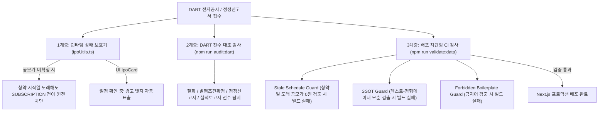

# 공모주 데이터 무결성 및 공시 동기화 표준 운영 프로세스 (SOP)

본 문서는 공시 일정 연기, 공모가 미확정 상태에서의 청약 상태 오표기, 텍스트와 정형 데이터 간의 모순 등 운영상 오류를 원천 방지하기 위해 구축된 표준 프로세스 및 자동 방어 체계를 정의합니다.

---

## 1. 핵심 불변 원칙 (Core Invariants)

1. **공모가 미확정 청약 불가능 원칙**
   - 대한민국 자본시장법 및 증권인수업무 규정상, **확정 공모가가 0원(미확정)인 상태에서는 어떠한 경우에도 일반 청약(`SUBSCRIPTION`)이 진행될 수 없습니다.**
   - 청약 시작일이 도래했더라도 확정 공모가가 없으면 시스템은 이를 `UPCOMING(청약 예정)` 상태로 강제 유지하며, UI에서는 `일정 확인 중` 경고 뱃지를 노출합니다.
2. **단일 진실 공급원(SSOT) 원칙**
   - 공모 일정, 희망/확정 공모가, 주관사 정보는 정형 데이터 필드(`subscriptionStart`, `underwriters`, `confirmedPrice` 등)가 유일한 진실입니다.
   - `aiSummary.bulletPoints` 등의 자연어 텍스트는 기업 비즈니스 모델 및 투자 포인트 중심으로 작성하며, 정형 데이터와 모순되는 자연어 텍스트는 CI 감사 단계에서 배포가 자동 차단됩니다.
3. **미검증 보일러플레이트 금지 원칙**
   - 증권신고서 접수 후 법정 대기 기간(15영업일) 중에는 "효력 발생 완료" 표기를 사용할 수 없습니다.
   - 펀더멘털이나 공모 구조에 대한 주관적 수식어("우수한 펀더멘털", "안정적인 공모 구조")는 공시 감사 및 실적 검증 전까지 사용할 수 없습니다.

---

## 2. 3계층 자동 방어 시스템 (Automated Safeguards)



### Layer 1: 런타임 상태 방어 (`src/lib/ipoUtils.ts` & `src/components/IpoCard.tsx`)
- `getEffectiveIpoStatus()`:
  - `today >= subscriptionStart` 조건이 성립하더라도, `confirmedPrice <= 0`인 경우 절대로 `SUBSCRIPTION`을 반환하지 않고 `UPCOMING`을 유지합니다.
- `IpoCard`:
  - 청약 시작일이 도래했으나 공모가가 미확정인 종목은 `"청약 진행 중"` 대신 **`"일정 확인 중"` (주황색 뱃지)**을 표시하여 사용자 혼선을 예방합니다.

### Layer 2: DART 공시 전수 대조 감사도구 (`npm run audit:dart`)
- 최근 60일간의 DART 지분증권(C001) 공시 목록을 실시간 전수 조회하여 다음 5대 괴리를 즉시 보고합니다:
  1. DART 공모 철회 공시 접수 시 DB 미반영 여부
  2. DART 증권발행실적보고서 접수 시 상장대기 전환 누락 여부
  3. DART 발행조건확정 공시 접수 시 공모가 0원 방치 여부
  4. DART 최신 기재정정공시(일정/조건 연기) 접수 시 미반영 여부
  5. 청약 시작일 도래 종목의 공모가 미확정 상태 여부

### Layer 3: 배포 사전 차단 무결성 감사 (`npm run validate:data`)
- Next.js 프로덕션 빌드(`npm run build`) 실행 전 `prebuild` 훅으로 강제 실행됩니다:
  1. **Stale Schedule Guard**: 오늘 날짜 기준 청약 시작일이 도래했으나 확정 공모가가 0원인 종목이 있으면 **즉시 exit code 1로 빌드 중단**.
  2. **SSOT Guard**: `bulletPoints`나 메모 내 주관사/유통비율이 정형 데이터와 0.01이라도 다르면 **빌드 중단**.
  3. **Forbidden Boilerplate Guard**: "효력 발생 완료", "우수한 펀더멘털" 등 허위/미검증 문구 검출 시 **빌드 중단**.

---

## 3. 일상 운영 절차 (Daily Operations SOP)

### [매일 오전 08:30 청약/공시 점검 루틴]
1. 터미널에서 DART 전수 대조 명령어 실행:
   ```bash
   npm run audit:dart
   ```
2. 검사 결과 확인:
   - `✨ 모든 DART 최신 공시와 로컬 데이터베이스가 100% 일치합니다.` -> 정상 완료.
   - `⚠️ 최신 공시 미반영 내역 감지` -> 안내된 종목의 정정 공시(청약일 변경, 발행조건확정 등)를 반영.
3. 배포 및 검증:
   ```bash
   npm run validate:data
   npm run build
   ```
   - 무결성 검증 통과 후 `origin/main`으로 푸시하여 프로덕션 자동 배포.
